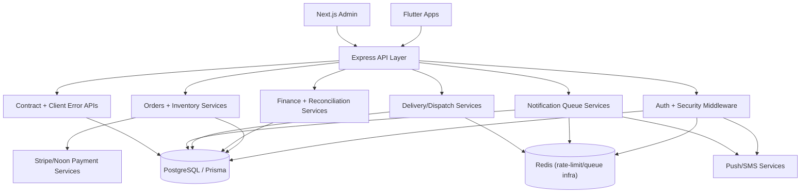

# Khubzati Dependency Graph (Execution Baseline)

## High-Coupling Modules
- `src/routes/orders.js` -> inventory, payments, recurring, notifications.
- `src/routes/finance.js` -> refunds, disputes, payouts, reconciliation, ledger.
- `src/routes/auth.js` -> OTP, token issuance, device tokens, login modes.
- `src/routes/admin.js` -> broad operations controls touching vendors/orders.

## Added Operational Domains
- Security event stream: `user_security_events`.
- Upload ownership + audits: `upload_audit_logs`.
- Inventory movement + cancellation reconciliation: `inventory_movements`, `order_cancellation_reasons`, `order_idempotency_keys`.
- Delivery orchestration: `delivery_slots`, `route_zones`, `driver_shifts`, `dispatch_jobs`.
- Finance ops maturity: `payout_accounts`, `vendor_ledger_entries`, `settlement_batches`.
- Scale observability: `kpi_daily_fact`, `notification_dead_letters`, `client_error_events`, `api_contract_versions`.
